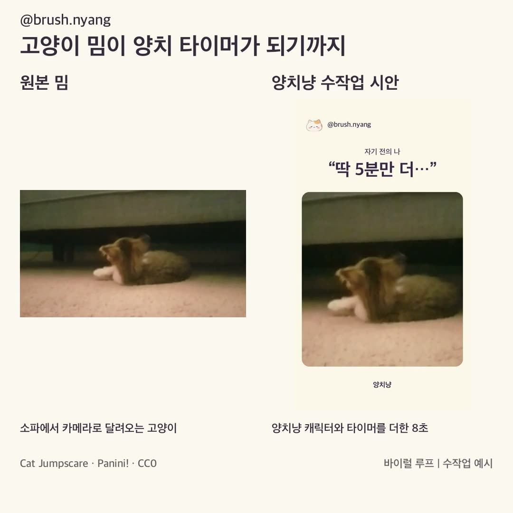

# 고양이 밈이 양치 타이머가 되기까지

[Watch in English](https://brainer3220.github.io/viral-loop-examples/en.html) · [영문 8초 촬영표 / English shot list](https://brainer3220.github.io/viral-loop-examples/shot-list-en.txt)

왼쪽은 소파에서 뛰어드는 고양이 원본이고, 오른쪽은 양치냥 캐릭터와 양치 타이머를 더한 8초 수작업 시안입니다. [영상 보기](https://brainer3220.github.io/viral-loop-examples/)

바이럴 루프에서는 자기 Instagram 계정과 원본 밈을 고르고, 세 기획 중 하나를 직접 선택해 영상을 만듭니다. 판매 준비 중이며 예정 가격은 최대 8초 영상 3편에 US$4.99입니다. [제품 소개](https://www.viraloop.drtryon.org/ko)

구매가 열릴 때 한 번 알림을 받으려면 support@drtryon.org로 “오픈 알림”이라고 보내 주세요.

원본 영상은 Panini!가 CC0로 공개한 *Cat Jumpscare*입니다. [원본 및 이용 조건](https://commons.wikimedia.org/wiki/File:Cat_Jumpscare.webm)
